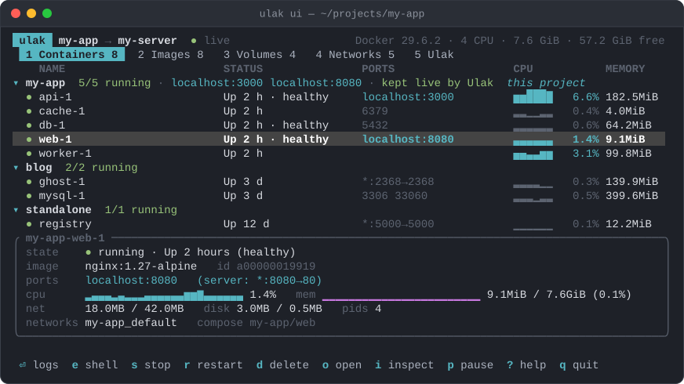
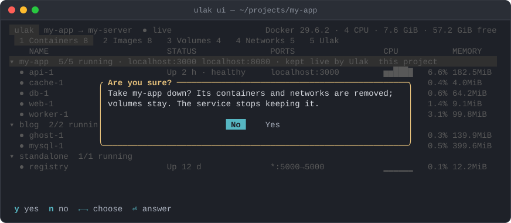
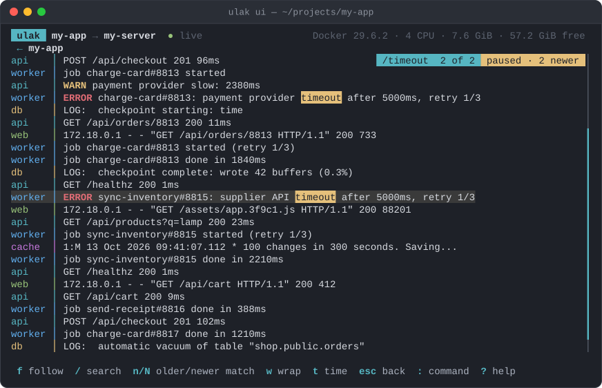
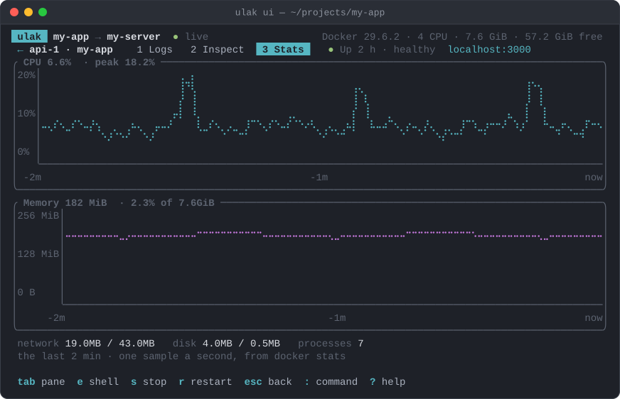

# The dashboard

`ulak ui` draws the server's Docker as a full-screen view in your terminal:
containers grouped by Compose project, their logs, inspect documents and live
CPU and memory, images, volumes, networks, and the stacks this machine keeps
running. It needs an interactive terminal; for something a script can read,
use `ulak status`.

The dashboard is in beta: its keys and layout may still change between
releases. Every action goes through the same command table and rules as
`ulak docker`, and destructive ones ask first. Tell us what is missing or
wrong at [github.com/syy/ulak/issues](https://github.com/syy/ulak/issues).

## Which server it shows

The same choice `ulak status` makes. Inside a Compose project, it is the
project's server, and that project is pinned to the top of the Containers tab
even when nothing runs yet. With several stacks declared there, it is the
server of a running one, and none is pinned. Inside an Ulak workspace without
a project, it is the workspace's server. Anywhere else, it is the global `host`, or else a
server this machine has declared stacks on. `@` switches to any server this
machine knows about.

The first connection is made before the screen is taken, so a passphrase or
host-key question can still be answered. Everything after that rides the same
shared SSH connection and never prompts: if the connection needs a question
answered again, the dashboard says the server is unreachable and keeps
retrying. Switching to a server with no open connection steps out of the
screen to connect, then comes back.

## Keys

Press `?` for the full list. The ones you need first:

| Key | Does |
|---|---|
| `tab` `←` `→` `1`–`5` | Switch tab: Containers, Images, Volumes, Networks, Ulak |
| `↑` `↓` `j` `k` | Move; `PgUp` `PgDn` `g` `G` jump |
| `⏎` | Logs of a container; fold a stack; inspect an image, volume or network |
| `l` | On a stack: every container's logs, merged by time |
| `e` | A shell inside the container (`bash` where the image has it, else `sh`) |
| `s` `r` `p` `K` | Stop or start, restart, pause or resume, kill |
| `d` `P` | Delete the selected item, prune the unused ones — both ask first |
| `u` `D` `S` | `compose up -d`, `compose down` (asks first), sync now |
| `o` `y` | Open its forwarded `localhost` port in a browser; copy its id |
| `/` | Filter the list; in logs and inspect, search (`n` older, `N` newer) |
| `:` | Run any `ulak docker …` command and watch its output |
| `T` | Tasks: everything the dashboard ran, with its output; `x` stops one |
| `q` `esc` | Back, or quit |

A destructive action says what it will remove and starts on No:

In logs, `f` pauses and resumes following, `w` wraps long lines, `t` shows
Docker's timestamps and `c` clears the view. Scrolling up pauses by itself and
says how many newer lines are waiting. On a stack, `l` merges every
container's lines by time, each in its own colour:

A container's `3 Stats` pane charts its last two minutes of CPU and memory,
one sample a second:

The mouse works too. Click a tab or a row, and double-click a row to open
it; the wheel scrolls. Each key named in the bottom line is a button that
presses that key, so `d delete` asks the same question the key does. Dialog
buttons can be clicked, and a click outside a dialog closes it the way `esc`
would, which never confirms. Because the dashboard reads the mouse, selecting
text needs Shift-drag in most terminals, or Option-drag on a Mac. It asks the
terminal for clicks and the wheel only, never for movement, and reads what is
still on its way before it gives the terminal back, so nothing you click or
type in it ends up in your shell.

## What it runs

Everything the dashboard asks of the server is an ordinary Docker command over
your SSH connection, recorded in the same audit trail as the commands you type.

- One snapshot round reads the containers, and whatever the current tab shows,
  in a single connection. It runs every 15 seconds, and at once when
  `docker events` reports a change. `docker system df`, which sizes every
  layer and volume, runs only while the Images or Volumes tab is open.
- `docker events` and `docker stats` stream while it is open, and
  `docker logs -f` while a log view is. A stack's merged view follows all of
  its containers in one session: OpenSSH allows ten sessions on a connection
  by default (`MaxSessions`), and one per container used them up. Each
  stream runs under a small watchdog that ends the remote command when the
  dashboard's end of the connection closes, so nothing is left running on
  the server after you quit, even after a crash.
- Container, image, volume and network actions are the Docker commands of the
  same name, checked against the same routing table as `ulak docker`.
  Compose actions, `sync`, `doctor` and the `:` prompt run `ulak` itself with
  the project's exact Compose flags, so they synchronize, keep stacks live and
  forward ports exactly as the same command typed in a terminal would.

Quitting with `q` while tasks still run asks first. Running tasks are then
stopped the way Ctrl-C would stop them, and the dashboard stays up, saying
what it waits for, until they finish or four seconds pass; `q` or Ctrl-C
again leaves at once. Ctrl-C quits from anywhere without asking, and stops
running tasks the same way.
